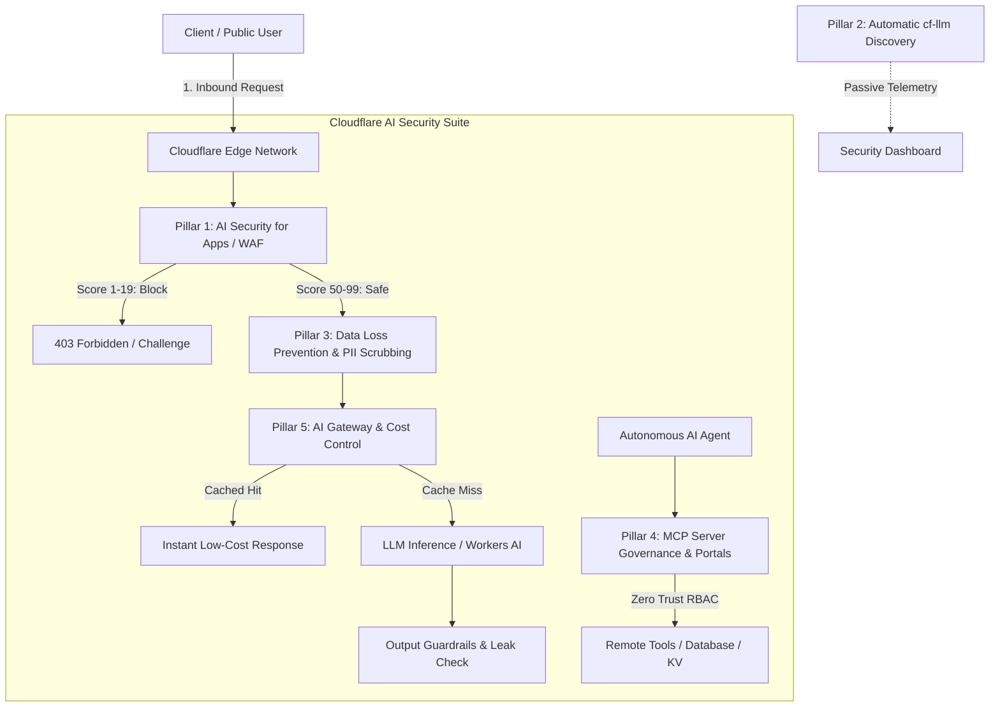

# Cloudflare AI Security Suite: Deep Architectural Study & Implementation for The Parenting Project Myanmar

## Executive Summary

As **The Parenting Project Myanmar** operates a nationwide, mission-critical digital platform serving churches, schools, and families across Myanmar, safeguarding user data, infrastructure, and conversational AI endpoints from hostile exploitation is paramount.

Cloudflare's **AI Security Suite** establishes an inline defense-in-depth perimeter designed to defend public-facing web applications, conversational AI interfaces, and Model Context Protocol (MCP) integrations against the **OWASP Top 10 for Large Language Models (LLMs)** and classical application threats.

---

## 1. The 5 Core Pillars of Cloudflare's AI Security Suite

### Pillar 1: AI Security for Apps (Inline WAF & Prompt Injection Defense)
- **Inline Reverse Proxy Inspection**: Sits in front of all public APIs and LLM inference points.
- **`cf.llm.prompt.injection_score` (1 to 99)**:
  - **1 – 19 (High Risk)**: Definite prompt injection, jailbreak attempts (`"Ignore all previous instructions"`, `"DAN mode"`, system prompt extraction, multi-lingual homoglyphs). Intercepted and blocked before reaching the backend.
  - **20 – 49 (Medium Risk)**: Suspicious heuristic (excessive delimiters, base64 blobs, roleplay overrides). Challenged via Managed Challenge.
  - **50 – 99 (Safe)**: Legitimate natural language parenting and ministry inquiries.
- **Model Poisoning & Denial of Service**: Limits prompt length and payload depth to prevent context exhaustion and denial-of-wallet (DoW) attacks.

### Pillar 2: Automatic AI Endpoint Discovery (`cf-llm`)
- Cloudflare edge automatically fingerprints HTTP traffic to detect LLM API patterns, JSON request payloads, and standard AI protocols.
- Tags matching routes with `cf-llm` metadata so enterprise security policies and WAF rules are automatically attached without manual route registration.

### Pillar 3: Workforce AI Security & Data Loss Prevention (DLP)
- **Shadow AI & PII Protection**: Inspects all user inputs, community prayer wall posts, and feedback.
- **PII Redaction Engine**: Automatically identifies and scrubs:
  - Myanmar phone numbers (`+95 9...`, `09...`)
  - Email addresses (`user@domain.com`)
  - National Registration Card (NRC) patterns
  - API keys, JWT tokens, and internal server credentials
- Protects family privacy and pastoral confidentiality under Myanmar's sensitive socio-political conditions.

### Pillar 4: MCP Server Governance (Model Context Protocol)
- **Zero Trust Tool Security**: Replaces unmanaged, vulnerable local MCP servers with **Remote MCP Servers on Cloudflare Workers**.
- **Least-Privilege Scoping**: Restricts AI models and agentic workflows to authorized read-only tool functions (`get_parenting_module`, `search_curriculum`).
- **Audit Logging**: Comprehensive, tamper-evident logging of every tool execution, caller identity, and argument payload.

### Pillar 5: AI Gateway & Cost Control
- **Unified Control Plane**: Edge-proxied routing to LLM providers (Workers AI, OpenAI, Anthropic).
- **Rate Limiting & Spending Guardrails**: Caps tokens per minute and requests per IP to prevent runaway billing.
- **Smart Edge Caching**: Frequently asked parenting questions (e.g. bedtime routines, toddler tantrum handling) return cached responses instantly at $0 compute cost.

---

## 2. Threat Analysis: The Parenting Project Myanmar

| Threat Vector | OWASP Classification | Potential Impact on Project | Defense Applied |
| :--- | :--- | :--- | :--- |
| **Admin Brute Force** | API6:2023 Unrestricted Resource | Attackers brute-forcing `cbn2026` passcode | IP sliding-window rate limit & temporary lockout (5 fails = 15m ban) |
| **Prompt Injection** | LLM01:2025 Prompt Injection | Overriding AI advisor to output inappropriate advice or exfiltrate prompts | Inline WAF scoring (`cf.llm.prompt.injection_score < 20` blocked) |
| **Family PII Leakage** | LLM06:2025 Sensitive Information Disclosure | Exposing telephone numbers and church locations of Burmese parents | Inline regex DLP scrubber masking PII before storage/model |
| **Prayer Wall Defacement** | API8:2023 Security Misconfiguration | Script injection (XSS) or scam links in public prayer wall | HTML entity escaping, URL sanitization, and length limits |
| **Denial of Wallet (DoW)** | LLM04:2025 Model Denial of Service | Flooding LLM with million-token inputs to exhaust quota | AI Gateway max token limits (1,500 chars max) + IP throttling |
| **Clickjacking & MIME Attacks** | Classical Web Attack | Embedding portal in malicious phishing iframe | Security headers: `X-Frame-Options: SAMEORIGIN`, `nosniff`, strict CSP |
| **Shadow MCP / Unauthorized Tools** | LLM07:2025 System Access Abuse | Rogue agent executing administrative database updates | MCP Zero Trust token authentication & read-only tool whitelist |

---

## 3. Implementation Plan Applied to `worker.js`

1. **Security Headers Middleware**:
   - `Content-Security-Policy`: Restricts script execution, frame embedding, and connects.
   - `X-Frame-Options: SAMEORIGIN`: Prevents clickjacking.
   - `X-Content-Type-Options: nosniff`: Prevents MIME confusion attacks.
   - `Strict-Transport-Security`: Enforces TLS across subdomains.
   - `Referrer-Policy: strict-origin-when-cross-origin`.
   - `Permissions-Policy: camera=(), microphone=(), geolocation=()`.

2. **Inline Edge Rate Limiter**:
   - Sliding-window in-memory bucket tracking requests per IP.
   - General API: Max 60 req/min.
   - Auth & Admin API: Max 10 req/min with 5-strike IP lockout.

3. **Inline Prompt Injection Filter (`cf.llm.prompt.injection_score`)**:
   - Analyzes all inbound prompts for jailbreak patterns, system prompt extraction, roleplay override, and encoded payloads.
   - Returns detailed security headers (`cf-llm-injection-score`, `cf-llm-action`).

4. **Data Loss Prevention (DLP) Filter**:
   - Automatically masks Myanmar phone numbers (`+95 9...`, `09...`) as `[PHONE REDACTED]`.
   - Masks emails as `[EMAIL REDACTED]`.
   - Strips malicious HTML/JavaScript tags from prayer and feedback text.

5. **Cloudflare AI Gateway Route (`/api/ai/parenting-assistant`)**:
   - Protected endpoint for parenting advice queries.
   - Inline prompt injection inspection.
   - Smart caching for common questions.
   - Token limit of 1,000 characters per prompt.

6. **MCP Server Governance Portal (`/api/mcp`)**:
   - Centralized Model Context Protocol tool endpoint.
   - Requires `Authorization: Bearer <mcp-token>`.
   - Whitelist of approved tools: `search_modules`, `get_devotional`, `verify_church_partner`.
